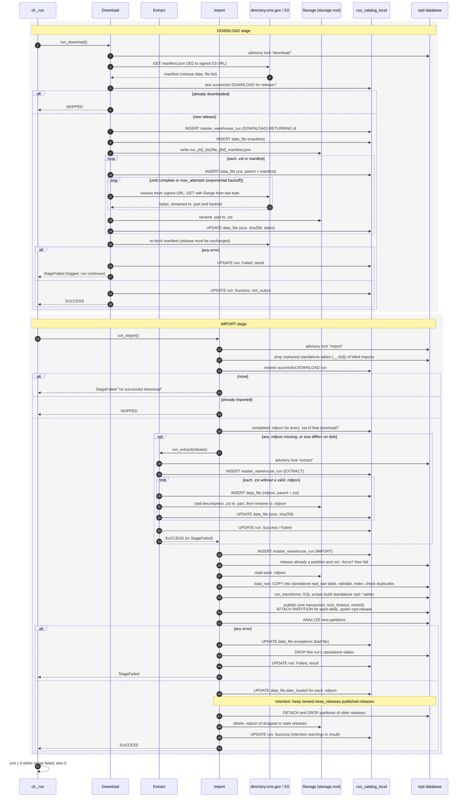

# `npd-loader run` sequence

`run` runs DOWNLOAD and then IMPORT. IMPORT runs EXTRACT itself when any `.ndjson` is missing. IMPORT runs even if
DOWNLOAD failed, because an earlier download may still need importing. The exit code is 1 if either stage failed.
Each stage takes a Postgres advisory lock in `npd`; if another process holds it, the stage logs "nothing to do"
and returns. All catalog writes autocommit on their own short connections, so they survive a failed load.

